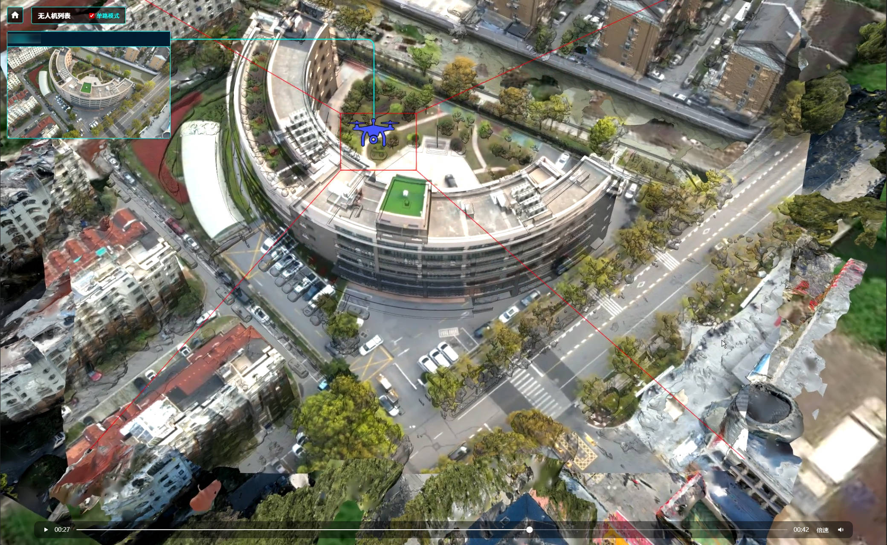

# VideoFusion-Web

无人机视频在三维实景模型上的**视频融合投射**方案：把每架无人机的实时画面，按相机位姿与 FOV 投影贴到倾斜摄影模型表面，形成"看得见、对得准"的空中监控视角。

> English: Design and architecture record for projecting live UAV video streams onto a 3D reality-mesh scene. Vue 3 + Vite + Cesium + EarthSDK3, driven by `ESVideoFusion`. **This repository currently contains design documentation only — no runnable source code.**



---

> ⚠️ **关于本仓库的状态**
>
> 这里记录的是一个已实现的方案的**架构设计与关键实现要点**，可运行的前端源码尚未整理入库。
> 保留这份文档的原因是：视频融合里真正难的从来不是调 API，而是**位姿对齐**和**多路流的状态管理**——
> 这两件事的结论比代码更难复现，所以先把它写清楚。
>
> 下方「模块职责」中的文件路径对应原始工程的目录结构，可作为复刻时的参考划分。

## 目录

- [要解决什么问题](#要解决什么问题)
- [核心功能](#核心功能)
- [技术栈](#技术栈)
- [模块职责](#模块职责)
- [端到端链路](#端到端链路)
- [关键实现要点](#关键实现要点)
- [复刻时需要准备的东西](#复刻时需要准备的东西)
- [已知坑](#已知坑)
- [许可](#许可)

## 要解决什么问题

常规做法是把无人机画面放在角落的监控小窗里看。问题是你得在大屏上不停地把"小窗画面"和"三维场景"两处做心算匹配——这条街在哪儿？那个路口是哪个方向？

视频融合换了个思路：直接把画面投影到模型表面。于是**画面和地物在同一空间里**，遮挡关系、朝向、覆盖范围全部自洽。代价是你必须把相机的外参（位置 + 姿态）、内参（FOV、画幅）和三维模型的坐标系严格对齐，任何一项偏了，投影就会整体错位。

## 核心功能

1. 在三维城市场景中加载多架无人机（经度 / 纬度 / 高度 + 姿态 + FOV）。
2. 每架无人机绑定一路视频源（HLS / MP4，预留 FLV）。
3. 点击某个视频小窗时：
   - 镜头飞到该无人机视角附近；
   - 开启该无人机的视频融合投射；
   - 关闭其余无人机的投射，仅保留位置指示。
4. 监控大屏式 UI：视频小窗、小窗到场景中无人机位置的连线、Home 复位。

**同一时刻只开一路投射**是刻意的设计。多路同时投影在视觉上会互相打架（半透明叠加），而且在 WebGL 下多路视频纹理的显存开销很陡。

## 技术栈

| 层 | 选型 | 作用 |
| :--- | :--- | :--- |
| 框架 | Vue 3 + Vite | 应用壳与构建 |
| 三维引擎 | Cesium | 场景、相机、3D Tiles |
| 视频融合 | EarthSDK3 (`ESVideoFusion`) | 把 video 元素按位姿投影到模型 |
| 流媒体 | Node Media Server + ffmpeg | RTMP ingest，切片为 HLS |
| 底图 | ArcGIS 影像 | 场景基底 |

## 模块职责

```text
src/
├── main.js                       # Vue 应用入口
├── App.vue                       # 页面壳，挂载 CesiumViewer
├── style.css                     # 全局全屏布局
├── config/
│   └── drones.js                 # 无人机配置：id/标签/视频地址/位置/姿态/FOV/画幅
└── components/
    └── CesiumViewer.vue          # 核心逻辑（见下）

stream_server/
├── start_stream.js               # Node Media Server + HTTP(8088) + ffmpeg 切片
└── package.json

public/                           # 3D Tiles、EarthSDK 资源、视频与图片
vite.config.js                    # Vue/Cesium/EarthSDK 静态资源拷贝
```

`CesiumViewer.vue` 承担了绝大部分复杂度，具体是四件事：

1. **初始化**：EarthSDK3 / Cesium Viewer、ArcGIS 影像底图、3D Tiles 场景加载。
2. **对象创建**：按 `drones.js` 逐个创建无人机实体与对应的 `ESVideoFusion` 投射对象。
3. **交互切换**：点击视频小窗 → 相机 `flyTo` 该无人机视角 → 切换投射开关（开当前、关其余）。
4. **UI 同步**：每帧把三维场景中无人机位置投影到屏幕坐标，驱动 DOM 连线的端点；以及 Home 复位。

## 端到端链路

```text
ffmpeg 切片  →  http://localhost:8088/live/<stream>/index.m3u8
                        │
                        ▼
              drones.js 里的视频地址
                        │
                        ▼
        CesiumViewer.vue 初始化场景 + 创建 ESVideoFusion
                        │
                        ▼
   <video> 元素播放 HLS → 激活时把 video 绑定到投射对象
                        │
                        ▼
          每帧同步 DOM 连线 <-> 三维无人机屏幕位置
```

关键点在于：`<video>` 元素只有一个，投射对象引用它。切换无人机时**不是重新创建 video**，而是把这个元素重新绑定到另一个 `ESVideoFusion` 实例上。这样避免了解码器反复初始化的卡顿。

## 关键实现要点

**位姿必须一次算对。** `drones.js` 里每架无人机的位置/姿态/FOV/画幅是一组强耦合参数，改一个就要重新核对投影落点。建议的校验办法：在场景里放几个已知坐标的地面标记（路口、楼角），让视频里的同一地物正好压在上面。

**本地 HLS 服务是为了绕开视频源限制。** 直接用 MP4 会失去流式能力，而真实无人机推的是 RTMP。所以 `start_stream.js` 用 Node Media Server 保留 RTMP ingest 通道，同时起一个 8088 端口的 HTTP 服务提供 HLS 文件；开发阶段用 ffmpeg 把本地 MP4 循环切成 `index.m3u8` + `.ts`，模拟真实推流。

**屏幕连线要跟着相机走。** 连线的两个端点分别在 DOM 和三维空间里，必须挂在渲染循环（`postRender` 或 `preRender`）里更新，否则相机一动连线就脱节。

**Home 复位要复位全套状态**：相机位置、投射开关、视频小窗的选中态。只复位相机的话，会出现"投射还开着但已经找不到是哪架无人机"的状态。

## 复刻时需要准备的东西

1. **Cesium Ion Token** —— 原工程里是写死在代码里的，复刻时请放到环境变量（`.env` + `VITE_CESIUM_TOKEN`），不要提交进仓库。
2. **3D Tiles 场景** —— 放在 `public/` 下，`CesiumViewer.vue` 里配置 URL。
3. **EarthSDK3** —— 视频融合能力来自它，需要按官方方式引入并拷贝静态资源（`vite.config.js` 里做）。
4. **ffmpeg** —— `stream_server/` 下需存在可执行的 `ffmpeg`（Windows 为 `ffmpeg.exe`）。
5. **演示视频** —— `public/Video/*.mp4`，用于生成默认 HLS。

目录与命令沿用原工程约定：

```bash
npm install                # 前端依赖
cd stream_server && npm install && npm start   # 本地流服务，8088
npm run dev                # 前端
```

## 已知坑

- **Cesium Ion Token 硬编码**。原工程写在源码里，开源前必须改成环境变量注入。
- **4096×2160 上限**。Cesium 画布受浏览器/显卡纹理尺寸限制，大屏下不要指望无限拉升。
- **多路投射的显存**。同时开多路视频纹理容易掉帧，所以产品逻辑上限制为单路激活。
- **HLS 延迟**。切片式 HLS 天然有数秒延迟；要低延迟得换 WebRTC，但浏览器端解码与 Cesium 的兼容性要重新验。

## 许可

[MIT](LICENSE)
